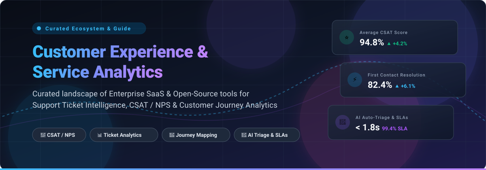

# Awesome Customer Experience & Service Analytics 📊✨

  

  
  
  
  

> **A curated showcase of top-tier Enterprise SaaS solutions and Open-Source software for Customer Experience (CX), Customer Service Analytics, Support Ticket Intelligence, CSAT/NPS Tracking, and Customer Journey Intelligence.**

---

## 📑 Table of Contents
- [🌐 Sector Overview & Market Dynamics](#-sector-overview--market-dynamics)
- [🏢 SaaS & Hosted Platforms](#-saas--hosted-platforms)
- [🔓 Open-Source GitHub Projects](#-open-source-github-projects)
- [🛠️ Architecture & System Implementation](#️-architecture--system-implementation)
- [🤝 How to Contribute](#-how-to-contribute)
- [💖 Support & Sponsorship](#-support--sponsorship)
- [⭐ Star History](#-star-history)
- [⚖️ Disclaimer](#️-disclaimer)

---

## 🌐 Sector Overview & Market Dynamics

The global **Customer Experience (CX) and Customer Service Analytics** market is valued at approximately **$14 billion to $20 billion** and is projected to expand past **$70 billion to $95 billion by 2032**, demonstrating an impressive **CAGR of 15%–18%**. 

The sector is currently **moderately fragmented with clear consolidation trends**:
- **Enterprise CRM & Cloud Monoliths** (*Salesforce, Microsoft, ServiceNow, Google Cloud*) anchor mission-critical operational data and dominate reporting with integrated business intelligence suites.
- **Dedicated CX & Feedback Leaders** (*Zendesk, Freshworks, Qualtrics, Medallia*) drive specialized omnichannel routing, conversational AI, and sentiment tracking.
- **Open-Source & Privacy-First Frameworks** (*PostHog, Chatwoot, Formbricks, erxes*) are rapidly capturing adoption among engineering and product teams demanding GDPR/HIPAA compliance, complete data ownership, and transparent self-hosted deployments.

---

## 🏢 SaaS & Hosted Platforms

A comprehensive comparison of leading commercial customer experience and service analytics platforms, sorted in descending order by **Company Valuation / Market Cap / ARR**.

| Product | Company Size (Market Cap / Valuation / ARR) | Starting Price | Free Tier / Free Trial Limits | Description |
|---------|---------------------------------------------|----------------|-------------------------------|-------------|
| **[Microsoft Power BI](https://powerbi.microsoft.com/)** | ~$3.1T Market Cap (Microsoft) / $245B+ ARR | $14 / user / month (Power BI Pro) | Free forever: Power BI Desktop (local report authoring only); 60-day free trial for Power BI Pro cloud features | Enterprise business intelligence platform for building unified CX dashboards from service, CRM, and call center logs. |
| **[Looker (Google Cloud)](https://looker.com/)** | ~$2.1T Market Cap (Alphabet) / $45B+ Cloud ARR | $5,000 / month ($60,000 / year base Standard tier) | Free forever for Looker Studio (basic dashboarding); core Looker BI requires sales-provisioned evaluation/PoC (no self-serve free trial) | Governed enterprise BI platform with semantic modeling (LookML) for real-time customer data warehouse metrics. |
| **[Salesforce CRM Analytics](https://www.salesforce.com/)** | ~$180B Market Cap / $41.5B ARR | $140 / user / month (Growth tier, annual billing) | 30-day free trial for Salesforce CRM / Analytics trial orgs; no free forever tier | Native analytics within Salesforce ecosystem for resolving customer cases, CSAT surveys, and omni-channel interaction data. |
| **[Tableau](https://www.tableau.com/)** | ~$180B Market Cap (Salesforce parent; $15.7B acquisition) | $15 / user / month (Viewer) / $75 / user / month (Creator, min 1 required) | Free forever: Tableau Public (all workbooks publicly visible); 14-day full platform free trial for Tableau Cloud | Interactive visual analytics engine frequently utilized for high-dimensional support operations and executive CX reporting. |
| **[ServiceNow Performance Analytics](https://www.servicenow.com/)** | ~$104B Market Cap / $15.4B ARR | ~$100 / fulfiller / month (bundled starting in ITSM/CSM Professional tiers) | Free forever: Personal Developer Instance (PDI sandbox for developer testing only); no commercial production free trial | Enterprise service intelligence and workflow analytics tracking SLAs, incident resolution velocities, and agent performance. |
| **[Zendesk Explore](https://www.zendesk.com/)** | ~$10.2B Private Valuation / ~$2B ARR | $19 / agent / month (Support Team) / $55 / agent / month (Suite Team) | 14-day free trial (access to Zendesk Suite Professional features, extendable once by 14 days upon request); no free forever tier | Native customer service analytics reporting on ticket queues, CSAT/NPS feedback, agent efficiency, and SLA compliance. |
| **[Freshworks Analytics](https://www.freshworks.com/)** | ~$3.3B Market Cap / ~$1B ARR | $19 / agent / month (Growth plan, annual billing) | Free forever: Freshdesk Free Plan for up to 2 agents (basic ticketing & knowledge base, limited analytics); 14-day trial for paid tiers | Service analytics embedded inside Freshdesk and Freshservice for monitoring response times, SLA breaches, and agent performance. |
| **[Sisense](https://www.sisense.com/)** | ~$1B+ Private Valuation / ~$140M ARR | ~$25,000 / year (Self-Serve / Essential starting tier) | 7-day free trial with full platform access (no credit card required); no free forever tier | Embedded analytics software allowing teams to build and embed customer-facing analytic dashboards into SaaS applications. |
| **[Domo](https://www.domo.com/)** | ~$150M Market Cap / ~$318M ARR | ~$30,000 / year (pre-purchased consumption credit model) | 30-day free trial with unlimited user seats and full platform data connectors; no free forever tier | Cloud data experience platform providing real-time executive dashboards, data integration pipelines, and prebuilt CX apps. |
| **[Klipfolio](https://www.klipfolio.com/)** | ~$35M Private Valuation / ~$15M ARR | $120 / month (Base plan, annual billing) | 14-day free trial of Klips (full feature access, up to plan limits); PowerMetrics has a limited free forever tier (2 metrics) | Dashboard builder with real-time KPI monitoring, multi-service connectors, and unlimited dashboard viewers. |

---

## 🔓 Open-Source GitHub Projects

Curated self-hosted software and developer toolkits for customer analytics, customer support intelligence, and experience tracking. **Sorted in descending order by GitHub Stars.**

| Project | Star Badge | Description |
|---------|------------|-------------|
| **[PostHog](https://github.com/PostHog/posthog)** |  | **All-in-one open-source product & customer experience analytics suite.** Provides session replay, customer event tracking, funnel intelligence, user path analysis, heatmaps, feature flags, and survey collection. |
| **[Chatwoot](https://github.com/chatwoot/chatwoot)** |  | **Open-source omnichannel customer engagement & support platform.** Direct open-source alternative to Intercom, Zendesk, and Drift. Includes live conversation analytics, first-response time tracking, CSAT ratings, and agent performance dashboards. |
| **[Formbricks](https://github.com/formbricks/formbricks)** |  | **Open-source survey suite and experience management platform.** Purpose-built for capturing in-app CSAT, Net Promoter Score (NPS), Customer Effort Score (CES), and targeted micro-surveys at specific points along the user journey. |
| **[Typebot](https://github.com/baptisteArno/typebot.io)** |  | **Open-source conversational form builder & conversational analytics engine.** Delivers visual conversational flows with drop-off analytics, response funnels, and real-time interaction metrics for customer support qualification. |
| **[Papercups](https://github.com/papercups-io/papercups)** |  | **Open-source customer messaging and customer support engine.** Features chat widgets, conversation metrics, response latency analytics, and integrations with Slack and webhooks. |
| **[FreeScout](https://github.com/freescout-help-desk/freescout)** |  | **Super-lightweight open-source help desk and shared inbox.** Self-hosted Help Scout alternative built with PHP/Laravel. Includes comprehensive reporting modules for ticket volume, response velocities, SLA tracking, and agent productivity. |
| **[erxes](https://github.com/erxes/erxes)** |  | **Complete open-source experience management operating system (XOS).** Direct alternative to HubSpot and Qualtrics. Self-hosted platform uniting team inboxes, customer telemetry, lead generation, task management, and customer journey orchestration. |
| **[Chaskiq](https://github.com/chaskiq/chaskiq)** |  | **Conversational marketing and support intelligence platform.** Full-featured open-source alternative to Intercom and Drift. Equips teams with messaging automation, audience segment metrics, and conversation analytics. |
| **[retentioneering-tools](https://github.com/retentioneering/retentioneering-tools)** |  | **Python library and toolkit for customer journey analysis and clickstream intelligence.** Features trajectory modeling, Markov chain simulation, behavioral segmentation, graph-based user path visualization, and churn forecasting. |
| **[Open Customer Insights](https://github.com/Nutlope/open-customer-insights)** |  | **Open-source customer insights workspace for support tickets, calls, and Slack transcripts.** Grounded AI chat, semantic discovery, customer journey timelines, competitor tracking, and MCP server connectivity. |
| **[Smart Support Analytics Dashboard](https://github.com/aroojjaved93/Smart-support-analytics-dashboard)** |  | **Python dashboard for tracking support team KPIs and ticket resolution.** Plots SLA breach trends, agent throughput distributions, and real-time support operational health via Plotly and Pandas. |
| **[django-customersatisfactionmetrics](https://github.com/pescheckit/customersatisfactionmetrics)** |  | **Pluggable Django package for collecting and managing CSAT, NPS, and CES surveys.** Includes impression tracking, cooldown logic, response metadata attribution, and relationship links to database models. |
| **[InsightPulse](https://github.com/iamjeshurun/InsightPulse)** |  | **Voice-of-customer intelligence platform for support feedback and reviews.** Employs NLP to classify customer sentiments, aspect categories (billing, access, product), urgency levels, and model confidence drift. |
| **[CustomerCore](https://github.com/saibalajinamburi/CustomerCore)** |  | **Real-time AI customer intelligence with multi-agent triage.** Built on Redpanda (Kafka), Apache Iceberg, dbt, and LangGraph. Executes automatic classification, SLA breach forecasting, and churn risk calculation in under 2 seconds. |

---

## 🛠️ Architecture & System Implementation

When deploying self-hosted customer service analytics, organizations typically assemble a modular pipeline:
1. **Engagement & Telemetry Layer**: Deploy [Chatwoot](https://github.com/chatwoot/chatwoot) or [FreeScout](https://github.com/freescout-help-desk/freescout) for ticketing and customer conversations.
2. **Feedback & Experience Signals**: Collect transactional CSAT, CES, and NPS surveys via [Formbricks](https://github.com/formbricks/formbricks) or [django-customersatisfactionmetrics](https://github.com/pescheckit/customersatisfactionmetrics).
3. **Journey & Churn Analytics**: Process event streams and interaction graphs through [PostHog](https://github.com/PostHog/posthog) and [retentioneering-tools](https://github.com/retentioneering/retentioneering-tools).
4. **AI Triage & Sentiment Analysis**: Connect multi-agent triage architectures like [CustomerCore](https://github.com/saibalajinamburi/CustomerCore) or NLP pipelines like [InsightPulse](https://github.com/iamjeshurun/InsightPulse) for sub-second classification.

---

## 🤝 How to Contribute

Contributions are warmly welcomed! Help us keep this directory up-to-date and accurate:

1. 🍴 Fork this repository.
2. 🌿 Create a new feature branch (`git checkout -b feature/new-analytics-tool`).
3. 📝 Add your entry to `README.md` following the alphabetical/sorting structure and table format.
4. 💡 Ensure you provide factual starting pricing, exact free tier limitations, star badges, and official links.
5. 🚀 Submit a Pull Request with a clear description of the project.

---

## 💖 Support & Sponsorship

If you find this curated ecosystem directory helpful for your research, company architecture, or open-source journey, please consider supporting the project!

- ⭐ **Star this repository** to help others discover it.
- 🍴 **Fork and share** with colleagues and technical communities.
- ☕ **Buy us a coffee / Sponsor**: Support ongoing maintenance and research on the [GitHub Sponsor Dashboard](https://github.com/sponsors/ishandutta2007). Every bit of support is deeply appreciated!

---

##  Star History

---

## ⚖️ Disclaimer

- This is a **community-curated index** created for educational and architectural reference — not an official endorsement of any vendor or framework.
- Customer support and interaction datasets routinely contain Personally Identifiable Information (PII) and sensitive customer sentiments. Ensure rigorous adherence to GDPR, CCPA, HIPAA, data encryption standards, and role-based access control (RBAC).

---

  <b>Built for CX Analysts, Support Engineers, Product Ops, and Customer Success Architects 🚀</b>

